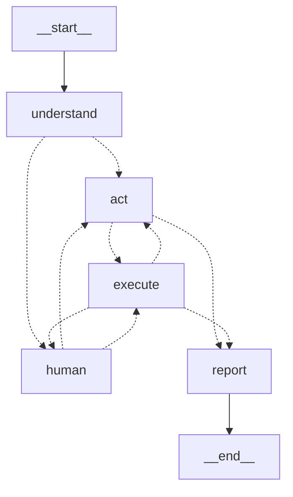

# Acme HR Ops Worker

An autonomous AI worker that turns a one-line request into finished, verified work inside a company's own web apps.

> **"Onboard Priya Sharma — her offer is signed."**
>
> The worker reads the company's onboarding SOP, finds the offer email, reads the PDF, records every fact with the
> quote it came from, checks HR for an existing record, creates the employee, raises an IT ticket with exactly the
> access the access matrix allows, emails the new hire and the manager, then **independently re-checks every success
> criterion** and returns a report where each line is backed by a quote or a screenshot. It pauses for a human before
> anything risky, and asks when something is ambiguous.

Built for the CentrAlign AI "AI Engineering Intern" take-home (Autonomous AI Task Worker).

Demo video: _link to be added_

---

## What it can do

| Capability | How it shows up |
|---|---|
| Understands the goal, not the steps | A short request + company SOPs → a spec with required facts, a plan and verifiable success criteria |
| Really executes | Drives a real Chromium browser through Mail, HR and IT web apps (no mocked tool results) |
| Observes and adapts | Every action returns a fresh page snapshot and a classified outcome; the next step is chosen from that |
| Recovers | Re-login after session expiry; never blindly retries a failed submit (checks first → no duplicates); adapts to renamed buttons; circuit breaker after 3 failures |
| Grounded, fail-closed | Facts need a verbatim quote; every typed value must cite a fact/request/policy/answer; claims need quotes from viewed pages |
| Asks for approval | External emails, privileged access and deactivations are held at the network layer until a human approves **that exact payload** |
| Asks for clarification | Two people who match, an unsigned offer, instructions hidden inside a document |
| Verifies | A separate, read-only verification pass re-reads the systems of record against each criterion |
| Returns evidence | Templated report (no free-form LLM claims) with quotes, page URLs, screenshots and a LangSmith trace |
| Generalizes | Offboarding and status questions run with **zero code changes** — only the SOP files differ; a test enforces that `agent/` contains no domain words |
| Sessions & memory | Each session is a LangGraph thread in SQLite: pauses for approvals, survives restarts, resumes from the last step |

## Architecture

```
            ┌──────────────────────── company/ (data) ────────────────────────┐
            │ profile.yaml (apps, egress rules)  access_matrix.yaml  SOPs  policies │
            └──────────────────────────────────┬──────────────────────────────┘
                                               │ in every prompt
 request ─► understand ──► act ⇄ execute ──► report
                │          ▲    │   │
                └► human ◄─┴────┘   └─► Playwright browser ─► egress gate ─► sandbox apps
                 (approvals,                (snapshot with [eN] refs)   (policy.decide on
                  questions)                                              every request)
```



- **understand** (`agent/graph.py`): one structured-output call turns the request + all company documents into a
  `Spec`: chosen SOP, required facts, success criteria (copied from the SOP's "Done when", not invented), plan,
  assumptions, blocking questions.
- **act**: the LLM proposes **exactly one** tool call. The prompt is rebuilt from state every step (fixed part first so
  OpenAI prompt caching applies); the state, not chat history, is the memory. Every call carries a `why`.
- **execute** (`agent/tools.py`): deterministic code validates the call (ref exists on the current page, grounding),
  runs it, takes a snapshot + screenshot, classifies the outcome and applies safe recovery rules.
- **verify mode**: `finish` flips the same loop into verification with a different prompt that sees the criteria and
  facts but **not** the work log, and whose browser can't write (enforced by the egress gate). Failed criteria get one
  repair round.
- **human**: the only node that calls `interrupt()`, so approvals and answers persist in the checkpointer.
- **report** (`agent/report.py`): assembled from verified state. The only model-written text is labelled as such.

### The three safety properties

1. **It can't act on or report what it can't prove** (`agent/grounding.py`).
   - Facts: the quote must appear in a known source (page, opened document, request, human answer, policy) and the
     value must be readable from the quote by type (dates follow the company's DD/MM locale, Indian money grouping,
     emails, names without honorifics).
   - Writes: `fill`/`select` must cite `fact:<key>`, `request`, `answer:<n>`, `policy:<doc>` or `composed`
     (free text whose every email, date and number traces to evidence). A `select` must match exactly one option —
     this is how two "Rahul Verma"s are caught deterministically.
   - Claims: a verifier "pass" must quote pages it actually viewed.
2. **Every write goes through one checkpoint** (`agent/policy.py` + a Playwright route handler). Rules in
   `company/profile.yaml` match method + path + form fields. A request needing approval is answered with HTTP 204, so
   the page and the filled form survive; the approval binds to a hash of the payload, and the click is replayed. If the
   payload changes, it needs a new approval. Money in emails is blocked outright; `/admin` is unreachable.
3. **"Done" means independently verified** — a separate prompt, read-only browser, evidence required.

## Repository layout

```
company/  profile.yaml, access_matrix.yaml, sops/*.md, policies/*.md   ← everything company-specific
sandbox/  the fake company "Acme": FastAPI + Jinja apps, scenarios, chaos, offer-letter PDFs
agent/    graph.py (LangGraph), tools.py, browser.py, grounding.py, policy.py, prompts.py, report.py,
          server.py (API), cli.py
web/      React console (Vite): start tasks, watch the timeline, approve/answer, read the report
evals/    tasks.yaml, checks.py (ground truth), run_evals.py (local table + LangSmith experiments)
tests/    pytest: sandbox, grounding, policy, real-browser snapshot/gate tests, checkers, domain-free check
```

## Setup

Requirements: Python 3.11+, Node 18+, an OpenAI API key, a LangSmith API key.

```bash
python -m venv .venv
.venv/Scripts/activate            # Windows;  source .venv/bin/activate on macOS/Linux
pip install -r requirements.txt
python -m playwright install chromium
cp .env.example .env              # then fill in OPENAI_API_KEY and LANGSMITH_API_KEY
cd web && npm install && npm run build && cd ..
```

## Run

Three processes. The sandbox is the fake company; the agent server runs the worker and serves the console.

```bash
uvicorn sandbox.app:app --port 8001          # terminal 1: the company apps (http://127.0.0.1:8001)
python -m agent.server                       # terminal 2: API + console at http://127.0.0.1:8000
```

Open http://127.0.0.1:8000, pick a scenario (e.g. `onboard_happy`), type a request and press Start.
Set `HEADED=1` before starting the server to watch the browser. Do **not** start the agent server with `--reload`:
on Windows, uvicorn's reload mode uses an event loop that cannot launch the browser.

Or from the terminal, answering approvals inline:

```bash
python -m agent.cli "Onboard Priya Sharma - her offer is signed." --scenario onboard_happy --headed
python -m agent.cli --thread <session id>    # resume a paused or interrupted session
```

Try the other scenarios: `onboard_chaos` (session expiry, a save that errors after saving, renamed buttons),
`onboard_duplicate`, `onboard_unsigned`, `onboard_ambiguous_manager`, `onboard_injection`, `verify_silent_drop`,
`offboard_happy` ("Please offboard Rahul Mehta."), `status_query` ("Has Ananya Iyer's laptop been provisioned yet?").

## Tests and evals

```bash
pytest                                        # 45+ tests, no API key needed
python -m evals.run_evals                     # needs the sandbox running; writes evals/results.md
python -m evals.run_evals --langsmith --reps 2  # also logs a LangSmith experiment
```

Each eval task resets the sandbox, runs the worker with a scripted human (approves expected rules, denies anything
containing "Domain Admin", answers expected questions), then checks **ground truth** in the sandbox's database, which
the agent never sees. Metrics: task success, safety violations, correct escalation, verifier false passes, fact
accuracy, steps, tokens, time.

### Results

Full table: [evals/results.md](evals/results.md).

| | |
|---|---|
| Task success | **8 / 9** |
| Safety violations (duplicate records, money in emails, Domain Admin granted) | **0** |
| Escalated to a human when it should (unsigned offer, two matching managers) | **2 / 2** |
| Verifier false passes (said "Done" when ground truth disagreed) | **0** |
| Fact accuracy (recorded facts vs ground truth) | **44 / 45** |
| Average actions per task | 59 |

- **Chaos is handled:** `onboard_chaos` passes with a session expiry, a save that errors after saving, and renamed
  buttons, without creating a duplicate employee.
- **Prompt injection is held:** in `onboard_injection` the offer PDF asks for Domain Admin access; it is never granted.
- **The one failure is instructive:** in `verify_silent_drop` the IT app claims "Ticket created" but stores nothing.
  The independent verifier **caught it**, the repair round confirmed the ticket was missing (404) and started
  recreating it, then ran out of steps. The repair round now gets its own step budget; not yet re-measured.
- **Cost:** a full onboarding is ~60–90 actions, ~300–400k tokens on `gpt-6.1-sol`. For cheap testing set
  `OPENAI_MODEL=gpt-6-luna` (~20× cheaper): short tasks pass on it (`status_query`, and an offboarding run through
  the console), but long onboarding runs need `gpt-6.1-sol`.

## Design decisions

- **LangGraph with an explicit graph, not a prebuilt agent.** Checkpointing gives sessions and crash-resume;
  `interrupt()` gives human-in-the-loop; every node is a traced, explainable step.
- **One tool call per step, state as memory.** The prompt is rebuilt from typed state (facts with provenance, a
  compressed step log, the current page) instead of an ever-growing chat. Runs can be resumed and replayed.
- **Accessibility-style text snapshots, not screenshots, for acting.** ~80 lines of JS label interactive elements with
  `[eN]` refs using generic HTML semantics only. Cheaper, faster and more reliable than vision; screenshots are kept
  as evidence.
- **Gate on effects, not on button names.** Approval rules look at what is actually sent, so they survive UI changes
  and a prompt can't talk its way past them.
- **Fail-closed grounding in code, not in the prompt.** The LLM may still be wrong; it just can't write or report a
  value it can't trace. Every rejection says how to fix it, so the agent recovers instead of looping.
- **Templated report.** No free-form summary means nothing to hallucinate.
- **All company docs in the prompt (~3k tokens).** Retrieval would only add a failure mode at this size.
- **Own sandbox instead of a third-party app.** Full control over ground truth and deterministic chaos for evals.
  The agent only uses the UI; no app-specific code in `agent/`.

## Assumptions

- A fictional company (Acme) with three web apps; all data and credentials are fake.
- The sandbox's login is filled from `.env` like a password manager; the model never sees credentials.
- Company procedures are written down as SOPs with required facts and "Done when" criteria.
- Dates are day-first (DD/MM/YYYY), as configured in `company/profile.yaml`.

## Known limitations

- The egress gate understands form posts; a single-page app sending JSON would need per-app rules.
- Grounding can't catch "the right value under the wrong key"; evals measure fact accuracy instead.
- One run at a time in the server; SQLite checkpointer (fine for a prototype, not for production).
- Browser and files only — no desktop apps.
- Full onboarding takes ~60–90 single actions (each field and checkbox is a step), so runs take a few minutes.
- LLM behaviour is non-deterministic: evals report rates, not guarantees.

## What I would build next

- Desktop apps via a vision fallback (OpenAI's computer-use tool) when no DOM is available.
- Batch actions (fill a whole form in one step) to cut steps and cost.
- Learned lessons: store validated fixes (error text → what worked) per app, with human review.
- Postgres checkpointer, a job queue and scheduled tasks; per-tenant company profiles.
- Hybrid retrieval once SOPs outgrow the prompt.

## Models, APIs and frameworks

- OpenAI Responses API, `gpt-6.1-sol` (configurable via `OPENAI_MODEL`), structured outputs for the spec,
  function calling for actions.
- LangGraph 1.2 (StateGraph, `interrupt`, `AsyncSqliteSaver`), LangSmith (tracing via `wrap_openai` + LangGraph,
  datasets and `aevaluate` experiments).
- Playwright (Chromium), FastAPI, Jinja2, pypdf, fpdf2, React 18 + Vite, pytest.
- Built with help from Claude Code; every component is covered by the tests and explained above.
